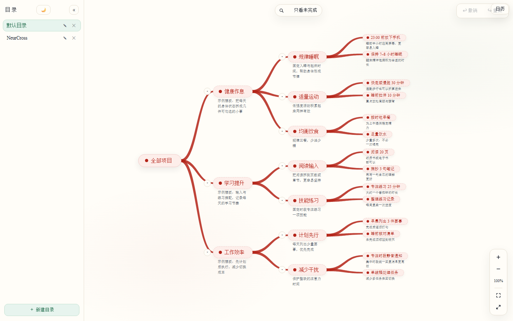
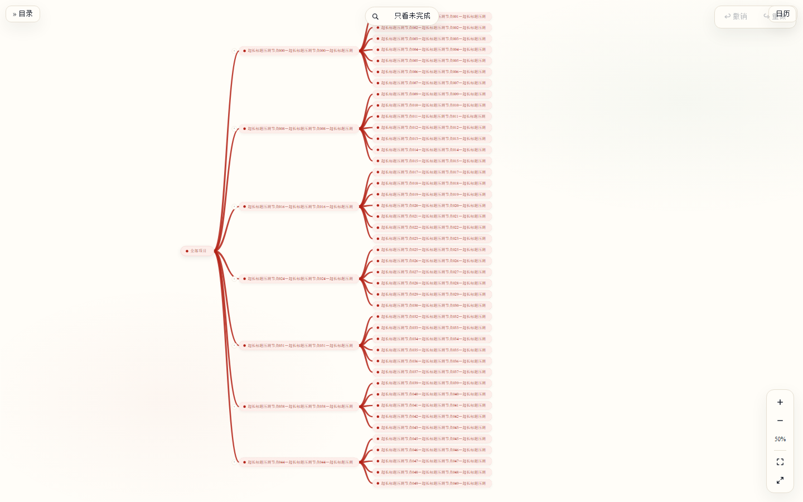
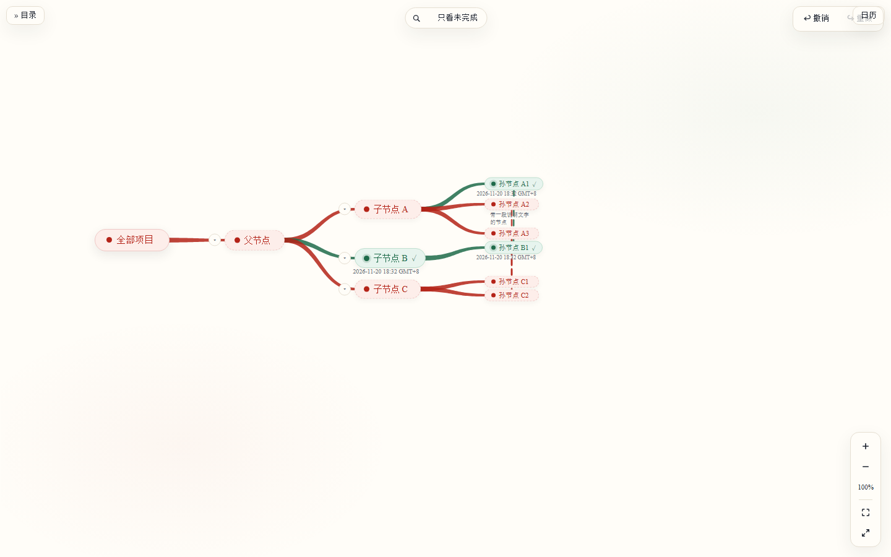
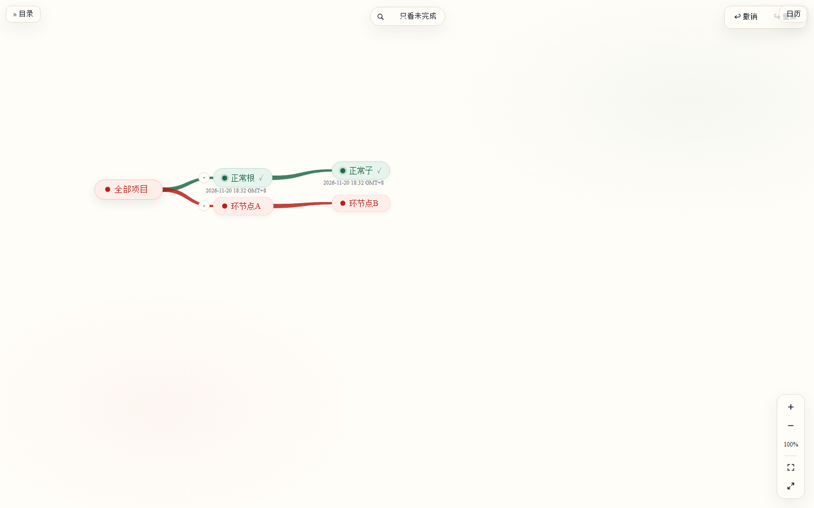
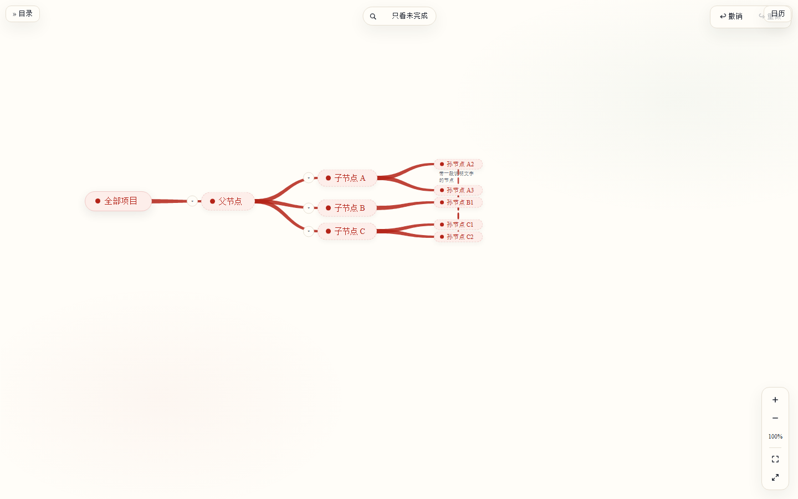
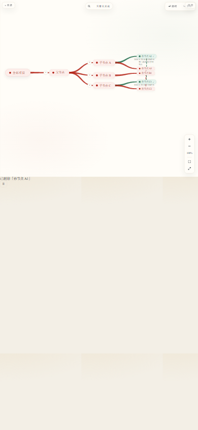
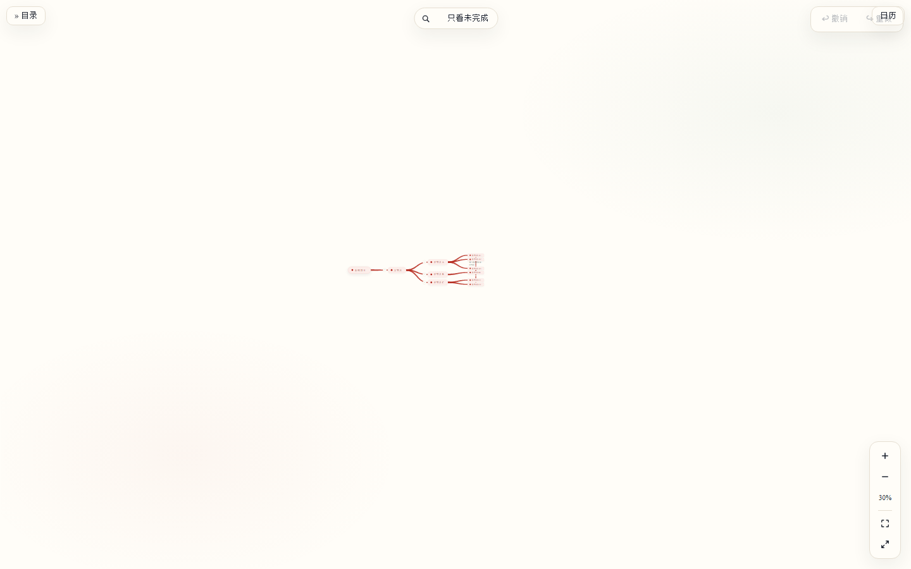
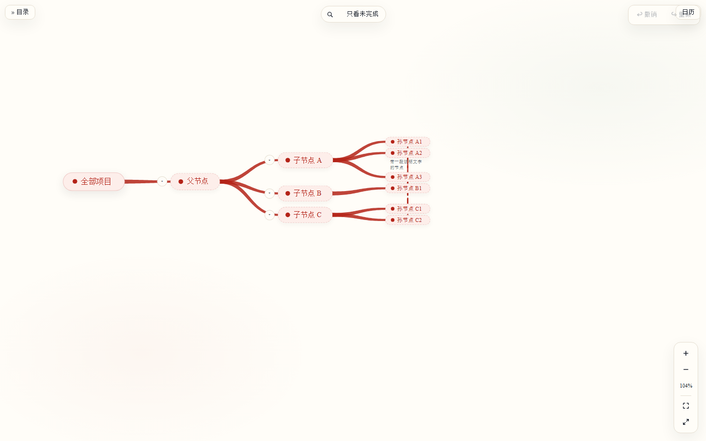
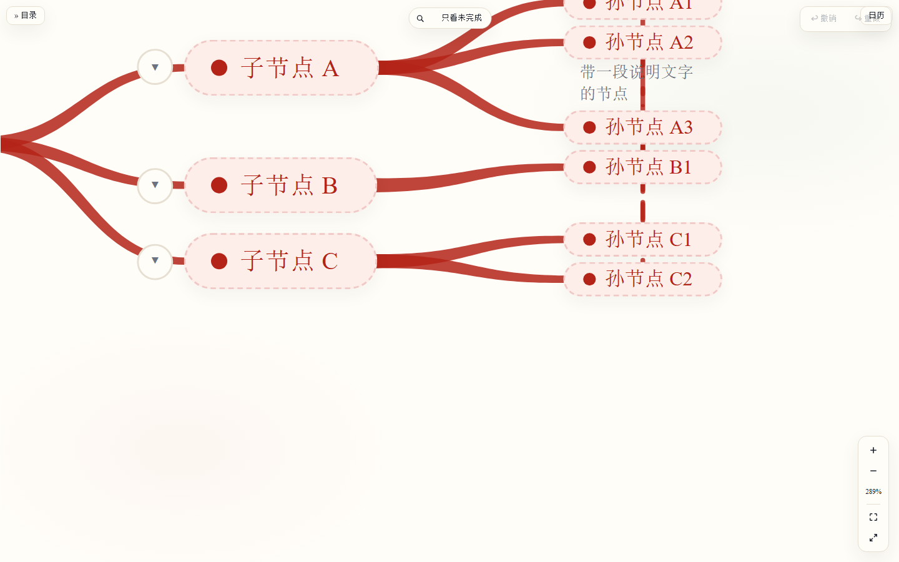
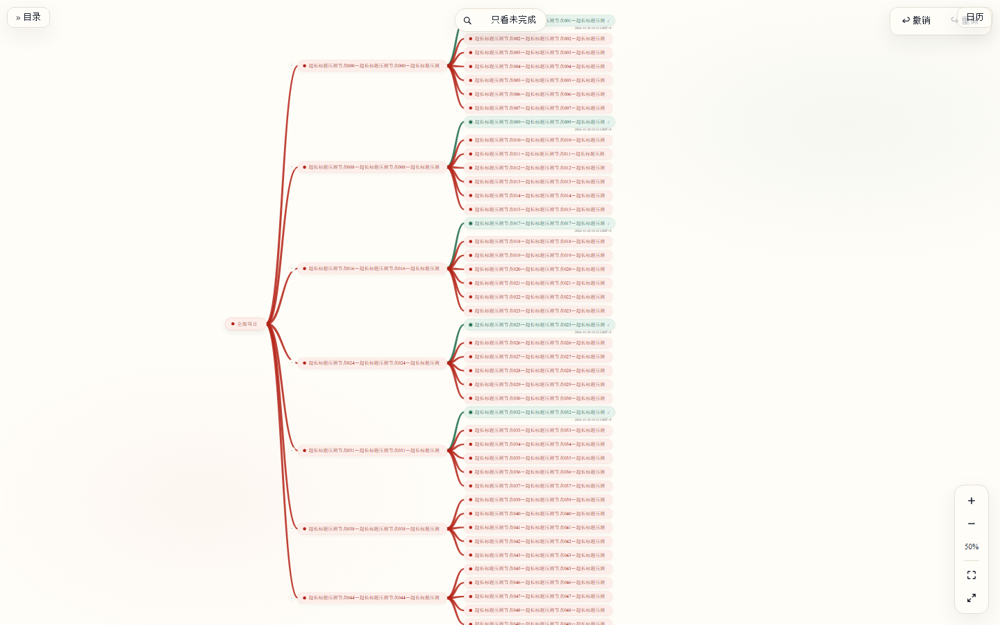

# 思维导图应用 PHASE-B 验收报告

- 被测文件：`C:\Users\25988\Desktop\.mindmap-test\x.html`
- 运行时间：2026-11-20T10:32:34.501Z（耗时 13.2s）
- 视口：1440x900（A6 单独使用 390×844 移动视口）
- 环境：Node v24.18.0，静态服务端口 8806，CDP 端口 9436（服务与 Edge 均由工装自起自清，只按 PID 杀）

## 结果总览

| 用例 | 场景 | 结果 |
|---|---|---|
| A1 | 加载默认树无异常 | ✅ PASS |
| A2 | 50节点+30字长标题布局 | ✅ PASS |
| A3 | 打卡后虚线端点贴合 | ✅ PASS |
| A4 | 环形JSON注入 | ✅ PASS |
| A5 | 删除带连线节点 | ✅ PASS |
| A6 | 移动端390×844 | ❌ FAIL |
| A7 | 缩放0.3/1/3后贴合 | ✅ PASS |
| A8 | 50节点5次打卡性能 | ✅ PASS |

## A1 加载默认树无异常

| 断言 | 预期 | 实际 | 结果 |
|---|---|---|---|
| ready | complete | complete | PASS |
| nodes | >=20(.mm-node) | 25 | PASS |
| branches | >=18(.mindmap-branch) | 24 | PASS |
| no-page-errors | 0 | 0 | PASS |

控制台错误/异常（7）

- `[log.error] Failed to load resource: the server responded with a status of 404 (File not found) @ http://127.0.0.1:8806/manifest.webmanifest
- `[log.error] A bad HTTP response code (404) was received when fetching the script.
- `[log.error] Manifest fetch from http://127.0.0.1:8806/manifest.webmanifest failed, code 404 @ http://127.0.0.1:8806/x.html
- `[log.error] Failed to load resource: the server responded with a status of 404 (File not found) @ http://127.0.0.1:8806/manifest.webmanifest
- `[log.error] Manifest fetch from http://127.0.0.1:8806/manifest.webmanifest failed, code 404 @ http://127.0.0.1:8806/x.html
- `[log.error] Failed to load resource: the server responded with a status of 404 (File not found) @ http://127.0.0.1:8806/icon-192.png
- `[log.error] Failed to load resource: the server responded with a status of 404 (File not found) @ http://127.0.0.1:8806/icon-512.png

## A2 50节点+30字长标题：无重叠/无反向/无竖脊

| 断言 | 预期 | 实际 | 结果 |
|---|---|---|---|
| nodes50 | 50(数据节点) | 50 | PASS |
| titleLen30 | 30字 | 30 | PASS |
| visible | 51(50+虚拟根) | 51 | PASS |
| overlap=0 | 相邻卡片重叠对数=0 | 0 | PASS |
| reverse=0 | .mindmap-branch 反向曲线数=0(起点x<终点x) | 0 | PASS |
| spine=0 | 竖脊 path 数=0(bbox宽<20且高>40) | 0 | PASS |

- 可见卡片 51/51，分支 50 条，重叠对 0，反向 0，竖脊 0

控制台错误/异常（7）

- `[log.error] Failed to load resource: the server responded with a status of 404 (File not found) @ http://127.0.0.1:8806/manifest.webmanifest
- `[log.error] Manifest fetch from http://127.0.0.1:8806/manifest.webmanifest failed, code 404 @ http://127.0.0.1:8806/x.html
- `[log.error] A bad HTTP response code (404) was received when fetching the script.
- `[log.error] Failed to load resource: the server responded with a status of 404 (File not found) @ http://127.0.0.1:8806/icon-192.png
- `[log.error] Failed to load resource: the server responded with a status of 404 (File not found) @ http://127.0.0.1:8806/manifest.webmanifest
- `[log.error] Manifest fetch from http://127.0.0.1:8806/manifest.webmanifest failed, code 404 @ http://127.0.0.1:8806/x.html
- `[log.error] Failed to load resource: the server responded with a status of 404 (File not found) @ http://127.0.0.1:8806/icon-512.png

## A3 打卡切换后虚线端点贴合(≤1.5px)

| 断言 | 预期 | 实际 | 结果 |
|---|---|---|---|
| drawn-afterOn | 3条全部画出 | 3 | PASS |
| maxdist-afterOn | 端点到接驳边中点距离≤1.5px | 0 | PASS |
| drawn-afterOff | 3条全部画出 | 3 | PASS |
| maxdist-afterOff | 端点到接驳边中点距离≤1.5px | 0 | PASS |
| no-missing-card | 连线端点卡片齐全 | 0 | PASS |

- **初始**：画出 3/3 条，端点最大偏差 0px；逐条 a1-b1:0/0，a2-c1:0/0，a3-c2:0/0

- **打卡后**：画出 3/3 条，端点最大偏差 0px；逐条 a1-b1:0/0，a2-c1:0/0，a3-c2:0/0

- **取消后**：画出 3/3 条，端点最大偏差 0px；逐条 a1-b1:0/0，a2-c1:0/0，a3-c2:0/0

控制台错误/异常（5）

- `[log.error] Failed to load resource: the server responded with a status of 404 (File not found) @ http://127.0.0.1:8806/manifest.webmanifest
- `[log.error] Manifest fetch from http://127.0.0.1:8806/manifest.webmanifest failed, code 404 @ http://127.0.0.1:8806/x.html
- `[log.error] Failed to load resource: the server responded with a status of 404 (File not found) @ http://127.0.0.1:8806/icon-192.png
- `[log.error] A bad HTTP response code (404) was received when fetching the script.
- `[log.error] Failed to load resource: the server responded with a status of 404 (File not found) @ http://127.0.0.1:8806/icon-512.png

## A4 环形JSON(A→B→A)注入刷新不白屏

| 断言 | 预期 | 实际 | 结果 |
|---|---|---|---|
| ready | complete | complete | PASS |
| no-white-screen | body 文本>0 且节点≥3 | 91/5 | PASS |
| no-page-errors | 0 | 0 | PASS |
| usable-toggle | 打卡状态可翻转 | false→true | PASS |

控制台错误/异常（7）

- `[log.error] Failed to load resource: the server responded with a status of 404 (File not found) @ http://127.0.0.1:8806/manifest.webmanifest
- `[log.error] Manifest fetch from http://127.0.0.1:8806/manifest.webmanifest failed, code 404 @ http://127.0.0.1:8806/x.html
- `[log.error] Failed to load resource: the server responded with a status of 404 (File not found) @ http://127.0.0.1:8806/icon-192.png
- `[log.error] A bad HTTP response code (404) was received when fetching the script.
- `[log.error] Failed to load resource: the server responded with a status of 404 (File not found) @ http://127.0.0.1:8806/manifest.webmanifest
- `[log.error] Manifest fetch from http://127.0.0.1:8806/manifest.webmanifest failed, code 404 @ http://127.0.0.1:8806/x.html
- `[log.error] Failed to load resource: the server responded with a status of 404 (File not found) @ http://127.0.0.1:8806/icon-512.png

## A5 删除带连线节点后无悬空link-hit

| 断言 | 预期 | 实际 | 结果 |
|---|---|---|---|
| menu-open | 右键菜单打开 | true | PASS |
| delete-clicked | 删除动作已触发 | true | PASS |
| node-gone | a1 已从 DOM 移除 | true | PASS |
| dangling-hit=0 | 无悬空 .mindmap-link-hit | 0 | PASS |
| stored-links-clean | localStorage 连线不含已删节点 | [{"a":"a2","b":"c1"},{"a":"a3","b":"c2"}] | PASS |

控制台错误/异常（5）

- `[log.error] A bad HTTP response code (404) was received when fetching the script.
- `[log.error] Failed to load resource: the server responded with a status of 404 (File not found) @ http://127.0.0.1:8806/manifest.webmanifest
- `[log.error] Manifest fetch from http://127.0.0.1:8806/manifest.webmanifest failed, code 404 @ http://127.0.0.1:8806/x.html
- `[log.error] Failed to load resource: the server responded with a status of 404 (File not found) @ http://127.0.0.1:8806/icon-192.png
- `[log.error] Failed to load resource: the server responded with a status of 404 (File not found) @ http://127.0.0.1:8806/icon-512.png

## A6 390×844移动端：无横向滚动/无原生弹窗

| 断言 | 预期 | 实际 | 结果 |
|---|---|---|---|
| no-h-scroll | scrollingElement.scrollWidth≤390 | 949 | **FAIL** |
| no-native-confirm | window.confirm 调用数=0 | 0 | PASS |
| no-native-alert | window.alert 调用数=0 | 0 | PASS |
| no-native-prompt | window.prompt 调用数=0 | 0 | PASS |

- scrollWidth=949，innerWidth=949，原生弹窗计数={"confirm":0,"alert":0,"prompt":0}；删除尝试路径={"open":{"ok":true,"step":"menu-open"},"del":{"ok":true,"step":"clicked-delete"},"settle":{"gone":true,"modalSeen":true,"modalClicked":1,"native":{"confirm":0,"alert":0,"prompt":0}}}
- 备注：**基线（未含 mobile-ux 修复）此处应 FAIL**——原生 confirm 被调用 1 次属任务说明的预期差异；横向溢出（scrollWidth>390）是基线在 390 宽下的真实表现（页面固有最小宽超出视口），同属 mobile-ux 修复范围。两项在候选版都应转为 PASS。

控制台错误/异常（7）

- `[log.error] Failed to load resource: the server responded with a status of 404 (File not found) @ http://127.0.0.1:8806/manifest.webmanifest
- `[log.error] A bad HTTP response code (404) was received when fetching the script.
- `[log.error] Manifest fetch from http://127.0.0.1:8806/manifest.webmanifest failed, code 404 @ http://127.0.0.1:8806/x.html
- `[log.error] Failed to load resource: the server responded with a status of 404 (File not found) @ http://127.0.0.1:8806/manifest.webmanifest
- `[log.error] Manifest fetch from http://127.0.0.1:8806/manifest.webmanifest failed, code 404 @ http://127.0.0.1:8806/x.html
- `[log.error] Failed to load resource: the server responded with a status of 404 (File not found) @ http://127.0.0.1:8806/icon-192.png
- `[log.error] Failed to load resource: the server responded with a status of 404 (File not found) @ http://127.0.0.1:8806/icon-512.png

## A7 缩放0.3/1/3后A3仍成立

| 断言 | 预期 | 实际 | 结果 |
|---|---|---|---|
| fit-z030 | 缩放到达目标(±6%) | 0.3(目标0.3) | PASS |
| maxdist-z030 | 端点贴合≤1.5px | 0 | PASS |
| fit-z100 | 缩放到达目标(±6%) | 1.044(目标1) | PASS |
| maxdist-z100 | 端点贴合≤1.5px | 0 | PASS |
| fit-z300 | 缩放到达目标(±6%) | 2.894(目标3) | PASS |
| maxdist-z300 | 端点贴合≤1.5px | 0 | PASS |

- **缩放0.3(实测0.3)**：画出 3/3 条，端点最大偏差 0px；逐条 a1-b1:0/0，a2-c1:0/0，a3-c2:0/0

- **缩放1(实测1.044)**：画出 3/3 条，端点最大偏差 0px；逐条 a1-b1:0/0，a2-c1:0/0，a3-c2:0/0

- **缩放3(实测2.894)**：画出 3/3 条，端点最大偏差 0px；逐条 a1-b1:0/0，a2-c1:0/0，a3-c2:0/0

控制台错误/异常（5）

- `[log.error] Failed to load resource: the server responded with a status of 404 (File not found) @ http://127.0.0.1:8806/manifest.webmanifest
- `[log.error] Manifest fetch from http://127.0.0.1:8806/manifest.webmanifest failed, code 404 @ http://127.0.0.1:8806/x.html
- `[log.error] A bad HTTP response code (404) was received when fetching the script.
- `[log.error] Failed to load resource: the server responded with a status of 404 (File not found) @ http://127.0.0.1:8806/icon-192.png
- `[log.error] Failed to load resource: the server responded with a status of 404 (File not found) @ http://127.0.0.1:8806/icon-512.png

## A8 50节点5次连续打卡耗时与DOM稳定性

| 断言 | 预期 | 实际 | 结果 |
|---|---|---|---|
| toggles-done | 5 次打卡全部执行 | 5 | PASS |

| 打卡 | 耗时ms | 其后 DOM 节点数 |
|---|---|---|
| b1l0 | 8.7 | 416 |
| b2l0 | 16.2 | 417 |
| b3l0 | 7.2 | 418 |
| b4l0 | 12.6 | 419 |
| b5l0 | 6.6 | 420 |

- 5 次连续打卡总耗时 **51.3ms**；DOM 节点数 416 → 417 → 418 → 419 → 420（波动 4，无阈值判定，仅记录）

控制台错误/异常（7）

- `[log.error] Failed to load resource: the server responded with a status of 404 (File not found) @ http://127.0.0.1:8806/manifest.webmanifest
- `[log.error] Manifest fetch from http://127.0.0.1:8806/manifest.webmanifest failed, code 404 @ http://127.0.0.1:8806/x.html
- `[log.error] Failed to load resource: the server responded with a status of 404 (File not found) @ http://127.0.0.1:8806/icon-192.png
- `[log.error] A bad HTTP response code (404) was received when fetching the script.
- `[log.error] Failed to load resource: the server responded with a status of 404 (File not found) @ http://127.0.0.1:8806/manifest.webmanifest
- `[log.error] Manifest fetch from http://127.0.0.1:8806/manifest.webmanifest failed, code 404 @ http://127.0.0.1:8806/x.html
- `[log.error] Failed to load resource: the server responded with a status of 404 (File not found) @ http://127.0.0.1:8806/icon-512.png

## 基线预期口径（重要）

- A2 / A3 在 base.html（commit 3e873f2，已含分支曲线与虚线现算两项修复）**应 PASS**——它们是已修复回归项的守卫。
- A6 的「无原生 confirm/alert」断言在基线**应 FAIL**（删除仍走原生 confirm，调用 1 次）——mobile-ux 修好后应 PASS；这是预期差异，报告注明。
